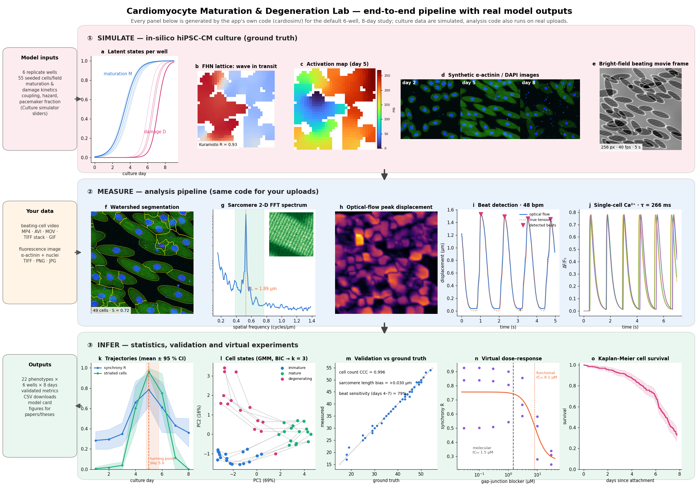

# Cardiomyocyte Maturation & Degeneration Lab (Day 1–8)

[](https://abusufian-cardiac-morphology-development.streamlit.app/)


An in-silico human iPSC-cardiomyocyte (hiPSC-CM) culture followed from day 1 to day 8, imaged with synthetic
microscopy, measured with a real image- and video-analysis pipeline that is **validated against the model's ground
truth**, analysed with longitudinal statistics, and probed with virtual experiments. The analysis pages also accept
**your own** beating-cell videos and fluorescence images.

**Live app:** https://abusufian-cardiac-morphology-development.streamlit.app/

> All culture data are simulated with parameters chosen inside ranges reported for hiPSC-CMs. They illustrate
> methods and mechanisms; they are not experimental measurements.

## Pipeline at a glance



**Figure 1. End-to-end block diagram built from real outputs of the app's code** (`scripts/make_figure.py`; nothing is
hand-drawn). **① Simulate:** (a) latent maturation *M* and damage *D* of the six replicate wells; (b) FitzHugh–Nagumo
lattice on the day-5 cell layout with an excitation wave in transit (white = no cell); (c) activation map of one wave;
(d) synthetic α-actinin (green) / DAPI (blue) images on days 2, 5 and 8 — punctate, then striated and aligned, then
fragmented with debris; (e) a frame of the bright-field beating movie. **② Measure** — the same functions run on your
uploads: (f) nuclei-seeded watershed segmentation (yellow cells, magenta nuclei); (g) 2-D FFT sarcomere spectrum of one
cell with its striations (inset); (h) optical-flow peak-displacement map; (i) detected beats on the optical-flow trace
against the true active tension; (j) single-cell Ca²⁺ transients. **③ Infer:** (k) synchrony and striated-cell fraction
(mean ± 95 % CI over wells) with the hinge-regression turning point; (l) phenotype state space with Gaussian-mixture
states (immature → mature → degenerating) and each well's path; (m) agreement of measurements with the ground truth;
(n) virtual gap-junction-blocker dose–response with Hill fit; (o) Kaplan–Meier survival of attached cells.

**Inputs:** model parameters (or the *Culture simulator* sliders) and, optionally, your own beating-cell video
(MP4, AVI, MOV, TIFF stack, GIF) or fluorescence image (TIFF, PNG, JPG).
**Outputs:** 22 phenotypes × 6 wells × 8 days, validation statistics, per-cell and per-beat tables (CSV), a model card,
and figures like this one.

## What the app does

| Page | Content |
|---|---|
| 🫀 **Home** | Study overview, headline results, day-by-day fluorescence timelapse |
| 🧫 **Culture simulator** | Any well on any day: α-actinin/DAPI image, beating bright-field movie, measured vs true readouts, per-cell table; design your own culture and run the full pipeline on it |
| ⚡ **Electrophysiology & calcium** | Voltage-wave movie, activation map, activation raster, Kuramoto synchrony R(t), single-cell Ca²⁺ transients (amplitude, time to peak, CaD50/90, decay τ), trajectories across days |
| 📈 **Longitudinal phenotyping** | 22 phenotypes × 6 wells × 8 days: mixed-model tests with FDR and ICC, Hedges' g heatmap, hinge-regression turning points with cluster-bootstrap CIs, Gaussian-process forecasts, PCA + Gaussian-mixture cell states (BIC), Kaplan–Meier survival, phenotype correlations |
| ✅ **Pipeline validation** | Measured vs ground truth: Pearson r, Lin's CCC, Bland–Altman bias and limits of agreement, beat-detection sensitivity/precision by day |
| 🎥 **Motion analysis** | Upload a video (MP4/AVI/MOV/TIFF/GIF) or use a simulated one: Farneback optical flow with automatic relaxed-reference selection, beat detection, contraction/relaxation kinetics, RR variability (Poincaré), displacement map, regional synchrony |
| 🔬 **Morphology & sarcomeres** | Upload an image or use a simulated one: nuclei-seeded watershed segmentation, shape descriptors, nematic orientation order, 2-D FFT sarcomere length and organisation score, per-cell spectra |
| 🧪 **In-silico experiments** | Gap-junction blocker dose–response with Hill fit, culture stress with Kaplan–Meier/log-rank, Morris global sensitivity analysis |
| 📑 **Methods** | Equations, parameter table, statistics, limitations, references |

## Model in brief

* **Agents:** replicate wells with random effects; cells attach, mature (logistic *M*), accumulate damage (logistic *D*)
  and die with hazard *h₀ + h₁D*; apoptotic cells show condensed or fragmented nuclei.
* **Electrophysiology:** FitzHugh–Nagumo oscillators on the Voronoi map of the living cells, gap-junction coupling that
  grows with maturation and falls with damage, maturation-dependent rate heterogeneity → Kuramoto-type synchronisation.
  Calcium release gate, SERCA-like decay, active tension ∝ Ca³ × sarcomere order.
* **Synthetic microscopy:** α-actinin Z-disc striations at the true sarcomere length with order-dependent disorder,
  DAPI nuclei, debris, PSF blur, Poisson–Gaussian noise; bright-field movies in which each cell shortens with its tension.

## Selected results (default study, 6 wells)

| Finding | Value |
|---|---|
| Synchrony (Kuramoto R) rises, peaks, then collapses | 0.28 (day 1) → **0.78 (day 5)** → 0.36 (day 8) |
| Turning point of synchrony (hinge regression, cluster bootstrap) | **day 5.0** (95 % CI 4.8–5.8) |
| Striated cells (periodic Z-disc signal in the FFT) | 0.6 % (day 1) → **96 % (day 5)** → 0 % (day 8) |
| Cell-state discovery (GMM on PCA, BIC) | **3 states**: immature, mature, degenerating |
| Attached cells that die by day 8 | 57 % (Kaplan–Meier) |
| Gap-junction blocker: functional IC₅₀ from synchrony | **8.1 µM** (95 % CI 2.8–23.4; Hill 2.1) vs molecular IC₅₀ 1.5 µM |
| Most influential parameter for the synchronous window (Morris μ*) | cell-to-cell beat-rate heterogeneity |

Validation against the simulator's ground truth (48 well-days):

| Readout | Lin's CCC | Bias | Comment |
|---|---:|---:|---|
| Attached cells | 0.996 | +0.02 cells | accurate |
| Orientation order S | 0.927 | −0.05 | accurate |
| Sarcomere length (striated cells) | 0.49 | +0.03 µm (LoA −0.04 to +0.10) | accurate in absolute terms; CCC is low only because the true range is < 0.1 µm |
| Cell aspect ratio | 0.48 | −0.55 (slope 0.43) | **attenuated**: watershed splits touching elongated cells |
| Ca²⁺ decay τ | 0.49 | −49 ms | **underestimated**: diastolic F₀ sits above resting Ca²⁺ when decay is incomplete |
| Beat detection (optical flow) | — | — | sensitivity 79 % on days 4–7, 38 % on days 1–3 (weak, asynchronous contraction) |

The functional IC₅₀ is about 5× the molecular one and the curve is steeper because synchrony is a threshold read-out of
coupling: a mature monolayer has a coupling reserve, and entrainment collapses only once conductance falls below a
critical value.

## Repository structure

```
app.py                     # home page
pages/                     # 8 Streamlit pages
cardiosim/
  model.py                 # latent states, agents, survival, ground-truth phenotypes
  ep.py                    # FitzHugh–Nagumo lattice, calcium, tension, synchrony, activation maps
  render.py                # synthetic fluorescence images and bright-field movies
  analysis.py              # segmentation, sarcomere FFT, optical flow, beat and calcium kinetics
  stats.py                 # mixed models, change-points, GP, GMM states, survival, Morris, Hill, Bland–Altman
  pipeline.py              # one well-day end to end (simulate → image → measure)
  io.py, ui.py             # upload readers, shared UI helpers
scripts/precompute.py      # regenerates data/ (≈ 8 min on 2 cores)
scripts/make_figure.py     # regenerates docs/figures/pipeline_block_diagram.png (needs matplotlib)
data/                      # pre-computed default study
docs/figures/              # README figure
```

## Running locally

```bash
pip install -r requirements.txt        # Python 3.10–3.12
streamlit run app.py
python scripts/precompute.py           # optional: regenerate data/
pip install matplotlib && python scripts/make_figure.py   # optional: regenerate Figure 1
```

## Limitations

Phenomenological electrophysiology (conduction velocities in model units), a single 2-D field, no fibroblasts or
mechanics between cells, and simulated rather than measured data. See the Methods page for details.

## Author

Md Abu Sufian · ORCID [0009-0007-3503-6942](https://orcid.org/0009-0007-3503-6942)
